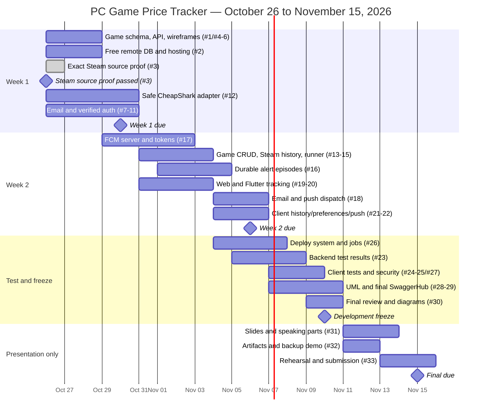

# Project plan

**Scope revised October 26, 2026:** the existing [33 GitHub issues](https://github.com/aluciencozy/price-tracker/issues), [4 milestones](https://github.com/aluciencozy/price-tracker/milestones), and [9 planning labels](https://github.com/aluciencozy/price-tracker/labels) now track a **$0 PC-game MVP**, using CheapShark with Steam URLs first. No replacement issue backlog or new boilerplate is needed. Development still finishes **November 10**; **November 11–15** is for presentation, rehearsal, and submission. Final submission is due **November 15**, using the course's actual deadline/time zone. These are planned tasks, not claims that features are implemented.

## Team

| Person | GitHub | Main responsibility |
| --- | --- | --- |
| Alex | @aluciencozy | Project lead, PR reviews, Flutter |
| Martin | @Martaino | React, TypeScript, Tailwind |
| Ibrahim | @IbrahimShaqqou | Database/infrastructure in week 1, then backend/testing |
| James | @MageOfLight | Express TypeScript shared API |
| Nick | @NickTheBrick04 | CheapShark integration, game matching, notification adapters |

The mapping is confirmed by the previous `aluciencozy/contact-manager` issues, PR authors, and contributors. At initial publication on October 23, Martin had accepted and Ibrahim, James, and Nick were pending. The October 26 issue snapshot still has the assignment counts below; invitation status may have changed separately. This scope edit preserves existing assignments, issue states, checklists and comments rather than assuming a successful API write assigns someone.

| Owner | Planned issues | Actual GitHub assignments | Pending assignment |
| --- | --- | --- | --- |
| @aluciencozy | 7 | 7 | 0 |
| @Martaino | 6 | 6 | 0 |
| @IbrahimShaqqou | 7 | 0 | 7 |
| @MageOfLight | 6 | 0 | 6 |
| @NickTheBrick04 | 7 | 0 | 7 |
| **Total** | **33** | **13** | **20** |

The 20 unassigned issues retain explicit owner mentions and the initial pending-assignment notes; assign them when eligible. Alex reviews PRs. Dependencies mean final integration must wait, not that contract/offline-fixture work cannot start.

## Scope and guardrails

- **Required stack:** remote MongoDB, Express/Node TypeScript API, React TypeScript/Tailwind web app, and Flutter Android app. Both clients use the same API and account data.
- **Account security:** email verification before login, password reset, expiring/revocable JWT access, server-derived ownership, admin-only manual checks, validation, rate limits, and safe secrets/logging.
- **Game scope:** real PC base games, Steam `/app/<id>` URLs first, US market and USD. Start with a small validated base-game catalog. DLC, bundles, subscriptions, guessed editions, physical goods, and arbitrary URLs are unsupported. GOG/Fanatical are optional only after exact matching is verified and must not delay the freeze.
- **Keep the reasons:** [the provider decision guide](provider-decisions.md) records excluded stores, request/cache limits, storage restrictions, unverified access, and source links. Do not reopen a rejected integration without checking that guide and the current terms.
- **Shared offers:** identity is `(provider, providerGameId, storeId, market, currency)`. Keep Steam app ID, CheapShark game ID and changing deal ID separate. User-owned trackers hold targets/preferences. Store integer USD cents, show the exact Steam offer and source before save, and never substitute an all-store cheapest price or historical low.
- **Checks/history:** one free CheapShark provider, our own dated successful observations, and an independent daily job. Scheduler and admin-only manual action share one service/cache/budget. Fetch a shared game once per run/window, select its Steam offer, isolate failures, and preserve the last valid observation with honest stale status on failure.
- **Alerts:** follow the exact rules in [project.md](project.md#alert-rules-do-not-send-the-same-alert-every-day). Persist below-or-equal-target episodes and independent email/push delivery state. Deduplicate across overlapping runs, retries, and restarts; target-update replays and channel toggles do not replay alerts. Explicitly handle unknown external-send outcomes rather than claiming impossible exactly-once delivery.
- **Android FCM push and email are required**, not stretch goals. Prove real delivery and test foreground/background/tap, permission, token rotation, and logout/account switching.
- **Steam source proof complete:** [the measured October 26 results](cheapshark-proof.json) verify Portal 2 and Half-Life 2: exact Steam app IDs, matching CheapShark game IDs, and current Steam offers. Four native Node.js API requests returned HTTP 200. [#3][i3] records this proof; it is no longer an unresolved task for Nick. [#12][i12] still implements the application adapter. The API requires an honest descriptive `User-Agent`; `/redirect` is for humans and must not be fetched automatically.
- **Provider adapter:** [#12][i12] calls fixed CheapShark API endpoints, not submitted Steam URLs or retailer HTML. Offline fixtures cover identity/money/offer/throttle/security cases. A training-store parser, extra physical provider, or required live mock-price mode is removed from scope.
- **Provider safety/use:** approved HTTPS host/path, validated IDs and actual DNS/IP destinations, safe redirect policy, timeouts/body limits and failure isolation apply to preview/checks. Respect 429/Retry-After; no bypass or paid fallback. Keep attribution and required CheapShark purchase redirects in both clients and alerts. Record fetch time separately from optional source-change time; history is our observations, not a fabricated historical-low series.
- **$0 infrastructure:** hosting vendor is undecided. Verify free remote MongoDB, HTTPS API/web deployment, independent scheduling, email, FCM and course-tool quotas before choosing services. No payment card, billing-enabled trial, automatic overage, paid plan or new domain. Existing domains are available. Stop/reduce scope at a free limit and escalate any unavailable required course tool instead of purchasing it.
- **Real presentation:** use a real Steam price, first a target below it, then a target above it, and repeat the qualifying check without duplicate email/push. Explain that the target changed, not that a sale started. Tests can simulate transitions offline; the outage backup is a clearly labeled recording of real evidence.
- **Required evidence:** Gantt, ERD, PlantUML use-case plus sequence diagram, PlantUML mobile class diagram, actual SwaggerHub publication, checked-in web/mobile wireframes **not Figma**, dated unit/integration/security results, demo, and presentation.
- This plan builds on the approved scaffold. There is no bootstrap/initialization issue and no duplicate setup work.

## Weekly milestones

| Milestone | Due | Outcome |
| --- | --- | --- |
| [Week 1 — Foundations and authentication](https://github.com/aluciencozy/price-tracker/milestone/1) | Oct 30 | Game/store schema/API, $0 hosting/remote DB plan, Steam proof done Oct 26, CheapShark adapter, verified account access |
| [Week 2 — Tracking and notifications](https://github.com/aluciencozy/price-tracker/milestone/2) | Nov 6 | Owned game CRUD/search, observed Steam history, daily checks, durable alerts, email and Android FCM |
| [Week 3 — Test and freeze development](https://github.com/aluciencozy/price-tracker/milestone/3) | Nov 10 | Deployment, recorded tests/security review, final technical docs, frozen release |
| [Presentation and submission](https://github.com/aluciencozy/price-tracker/milestone/4) | Nov 15 | Nov 11–15 slides, artifacts, rehearsal, and submission only |

## Gantt

Dates are inclusive in the table. Gantt bars end the following day to show the complete planned due date. Foundation work is rebaselined from the October 26 scope decision, while all milestone deadlines remain unchanged. Numbers refer to linked issues. [#3][i3] was completed October 26; overlapping bars still allow contract/offline-fixture work before the application adapter is finished.

## Planned work

All **33 published issues** contain an owner mention, planned start/due dates, a description, acceptance checkboxes, and explicit linked dependencies. `—` means no blocking issue; contracts still need normal team coordination. Full acceptance checklists live in the linked issues.

| Issue | Task | Owner | Start | Due | Dependencies |
| --- | --- | --- | --- | --- | --- |
| [#1][i1] | Game/store MongoDB identity/money contract, first ERD | @IbrahimShaqqou | Oct 26 | Oct 27 | — |
| [#2][i2] | Free remote MongoDB and hosting/scheduler plan | @IbrahimShaqqou | Oct 26 | Oct 28 | [#1][i1] |
| [#3][i3] | **Done Oct 26:** free Steam URL-to-offer source proof | @NickTheBrick04 | Oct 26 | **Oct 27** | —; research completed and recorded in the issue |
| [#4][i4] | Game API contract and first SwaggerHub draft | @MageOfLight | Oct 26 | Oct 28 | [#1][i1] |
| [#5][i5] | Web game wireframes and React page layout | @Martaino | Oct 26 | Oct 27 | — |
| [#6][i6] | Mobile game wireframes and first Flutter class diagram | @aluciencozy | Oct 26 | Oct 27 | — |
| [#7][i7] | Shared email adapter and real sender verification | @NickTheBrick04 | Oct 26 | Oct 28 | [#2][i2], [#4][i4] |
| [#8][i8] | Registration and email verification API | @MageOfLight | Oct 26 | Oct 28 | [#1][i1], [#4][i4], [#7][i7] |
| [#9][i9] | JWT login/logout, authorization, password reset | @MageOfLight | Oct 28 | Oct 30 | [#8][i8], [#7][i7] |
| [#10][i10] | Real web authentication flow | @Martaino | Oct 26 | Oct 30 | [#4][i4], [#5][i5], [#8][i8], [#9][i9] |
| [#11][i11] | Real Flutter authentication flow | @aluciencozy | Oct 27 | Oct 30 | [#4][i4], [#6][i6], [#8][i8], [#9][i9] |
| [#12][i12] | Steam-first CheapShark adapter and safe exact matching | @NickTheBrick04 | Oct 26 | Oct 30 | [#1][i1], [#3][i3]; source proof passed, so fixtures and adapter work can start |
| [#13][i13] | Owned Steam game preview/CRUD/search and shared offers | @MageOfLight | Oct 31 | Nov 3 | [#1][i1], [#4][i4], [#9][i9], [#12][i12] |
| [#14][i14] | Observed Steam price history and owned history API | @IbrahimShaqqou | Oct 31 | Nov 3 | [#1][i1], [#3][i3], [#4][i4], [#9][i9] |
| [#15][i15] | Independent daily scheduler and admin-only manual check | @NickTheBrick04 | Oct 31 | Nov 3 | [#2][i2], [#9][i9], [#12][i12], [#14][i14] |
| [#16][i16] | Durable alert episodes and per-channel outbox | @IbrahimShaqqou | Nov 1 | Nov 4 | [#1][i1], [#13][i13], [#15][i15] |
| [#17][i17] | Android FCM setup and owned token API | @IbrahimShaqqou | Oct 29 | Nov 2 | [#1][i1], [#2][i2], [#4][i4], [#9][i9] |
| [#18][i18] | Durable email and Android push dispatch | @NickTheBrick04 | Nov 4 | Nov 6 | [#7][i7], [#16][i16], [#17][i17] |
| [#19][i19] | Web Steam game watchlist, CRUD and attribution | @Martaino | Oct 31 | Nov 3 | [#10][i10], [#13][i13] |
| [#20][i20] | Flutter Steam game watchlist, CRUD and attribution | @aluciencozy | Oct 31 | Nov 3 | [#11][i11], [#13][i13] |
| [#21][i21] | Web history and alert preferences | @Martaino | Nov 4 | Nov 6 | [#14][i14], [#16][i16], [#19][i19] |
| [#22][i22] | Flutter history/preferences and real Android FCM | @aluciencozy | Nov 4 | Nov 6 | [#14][i14], [#16][i16], [#17][i17], [#20][i20]; pair with [#18][i18] |
| [#23][i23] | Backend unit/integration results and recovery tests | @IbrahimShaqqou | Nov 5 | Nov 8 | [#9][i9], [#13][i13], [#14][i14], [#15][i15], [#16][i16], [#17][i17], [#18][i18] |
| [#24][i24] | Web tests, accessibility, and usability fixes | @Martaino | Nov 7 | Nov 9 | [#21][i21] |
| [#25][i25] | Flutter tests and Android push lifecycle evidence | @aluciencozy | Nov 7 | Nov 9 | [#22][i22], [#18][i18] |
| [#26][i26] | HTTPS deployment, remote DB, scheduler/worker | @IbrahimShaqqou | Nov 4 | Nov 7 | [#2][i2], [#9][i9], [#15][i15], [#17][i17], [#18][i18] |
| [#27][i27] | Deployed end-to-end and security review | @MageOfLight | Nov 7 | Nov 9 | [#18][i18], [#21][i21], [#22][i22], [#26][i26] |
| [#28][i28] | PlantUML use-case and alert sequence diagrams | @NickTheBrick04 | Nov 7 | Nov 9 | [#4][i4], [#15][i15], [#16][i16], [#18][i18] |
| [#29][i29] | Final SwaggerHub publication and API demo | @MageOfLight | Nov 9 | Nov 10 | [#4][i4], [#13][i13], [#14][i14], [#17][i17], [#26][i26], [#27][i27] |
| [#30][i30] | $0 Steam MVP release, real-price demo, diagrams, freeze | @aluciencozy | Nov 9 | Nov 10 | [#23][i23], [#24][i24], [#25][i25], [#26][i26], [#27][i27], [#28][i28], [#29][i29], [#1][i1], [#6][i6] |
| [#31][i31] | Slides, contribution notes, speaking parts | @aluciencozy | Nov 11 | Nov 13 | [#30][i30] |
| [#32][i32] | Required artifacts, submission checklist, backup demo | @NickTheBrick04 | Nov 11 | Nov 12 | [#30][i30] |
| [#33][i33] | Team rehearsal and final submission; Alex uploads | @Martaino | Nov 13 | Nov 15 | [#31][i31], [#32][i32] |

## Release checks and risks

1. **Source proof is recorded, not delegated.** [#3][i3] passed October 26 and links the actual two-game/four-request evidence. Build [#12][i12] from that measured contract; do not redo the research as an unresolved assignment. Normal feature tests still need to cover failures and identity. Never replace Steam with a cheaper store, historical low, fictional store or paid source.
2. **Use contracts to overlap work.** Client work starts with agreed offline API fixtures; final acceptance requires the real deployed/shared API and real Steam prices. Early schema/SwaggerHub reviews prevent late integration surprises.
3. **Push is on the critical path.** Start Firebase/Android setup in week 1, verify token routing and account isolation, and record real email plus FCM evidence by November 6.
4. **Reliability is persisted, not in memory.** Unique product/run/episode/delivery identities, locks/leases, and independent channel outcomes are required. Unknown external-send results need explicit reconciliation/uncertainty handling.
5. **Tests are part of each feature.** [#23][i23], [#24][i24], and [#25][i25] consolidate and record results; they are not permission to postpone all tests until week 3. Exact-store identity, USD parsing, attribution, safety, throttling, target-edit semantics and $0 settings are release gates.
6. **November 10 is the freeze.** Alex approves and reviews the release. November 11–15 adds no new features. Only an explicitly approved critical fix may change the frozen release, with retesting and updated evidence.

[i1]: https://github.com/aluciencozy/price-tracker/issues/1
[i2]: https://github.com/aluciencozy/price-tracker/issues/2
[i3]: https://github.com/aluciencozy/price-tracker/issues/3
[i4]: https://github.com/aluciencozy/price-tracker/issues/4
[i5]: https://github.com/aluciencozy/price-tracker/issues/5
[i6]: https://github.com/aluciencozy/price-tracker/issues/6
[i7]: https://github.com/aluciencozy/price-tracker/issues/7
[i8]: https://github.com/aluciencozy/price-tracker/issues/8
[i9]: https://github.com/aluciencozy/price-tracker/issues/9
[i10]: https://github.com/aluciencozy/price-tracker/issues/10
[i11]: https://github.com/aluciencozy/price-tracker/issues/11
[i12]: https://github.com/aluciencozy/price-tracker/issues/12
[i13]: https://github.com/aluciencozy/price-tracker/issues/13
[i14]: https://github.com/aluciencozy/price-tracker/issues/14
[i15]: https://github.com/aluciencozy/price-tracker/issues/15
[i16]: https://github.com/aluciencozy/price-tracker/issues/16
[i17]: https://github.com/aluciencozy/price-tracker/issues/17
[i18]: https://github.com/aluciencozy/price-tracker/issues/18
[i19]: https://github.com/aluciencozy/price-tracker/issues/19
[i20]: https://github.com/aluciencozy/price-tracker/issues/20
[i21]: https://github.com/aluciencozy/price-tracker/issues/21
[i22]: https://github.com/aluciencozy/price-tracker/issues/22
[i23]: https://github.com/aluciencozy/price-tracker/issues/23
[i24]: https://github.com/aluciencozy/price-tracker/issues/24
[i25]: https://github.com/aluciencozy/price-tracker/issues/25
[i26]: https://github.com/aluciencozy/price-tracker/issues/26
[i27]: https://github.com/aluciencozy/price-tracker/issues/27
[i28]: https://github.com/aluciencozy/price-tracker/issues/28
[i29]: https://github.com/aluciencozy/price-tracker/issues/29
[i30]: https://github.com/aluciencozy/price-tracker/issues/30
[i31]: https://github.com/aluciencozy/price-tracker/issues/31
[i32]: https://github.com/aluciencozy/price-tracker/issues/32
[i33]: https://github.com/aluciencozy/price-tracker/issues/33
